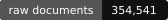

# UFO Files machine data

Generated OCR and media transcripts used by UFO Files projects.

The page count covers downloaded PDFs and TIFFs, including unprocessed files.
It updates automatically from the archive; the linked JSON includes measurement
time and uncounted files. ≥ indicates a minimum. Separate copies and alternate
formats count separately; other images, text, office documents and media are
excluded.

## Raw documents by collection

<!-- raw-document-collection-counts:start -->
| Collection | Raw documents |
| --- | ---: |

<!-- raw-document-collection-counts:end -->

The Brazil collection has a Portuguese-first processing path. See
[`docs/portuguese-processing.md`](docs/portuguese-processing.md) for its paired
Portuguese/English schema, provenance, safety limits, pilot, and Mac worker
operations.

## Field Station observations

Verified human-reviewed anomalies are ingested as versioned metadata in `Field-Station/`, with links to Internet Archive evidence. Reviews and original model predictions remain distinct. See [the observation schema and ingestion guide](docs/field-observations.md).

## Current licensing

Original UFO Files software is available under the **UFO Files Noncommercial Shared-Source License 1.0**: no commercial use; distributed derivatives and modified network services must provide corresponding source under the same terms. Original content is **CC BY-NC-SA 4.0**, only to the extent we control its rights.

See [LICENSE](LICENSE), [LICENSE-CONTENT.txt](LICENSE-CONTENT.txt), and [LICENSING.md](LICENSING.md) for scope, exceptions, and the transition from prior grants. These are source-available terms, not an OSI-approved open-source license. Third-party materials and public-domain records retain their own status.
